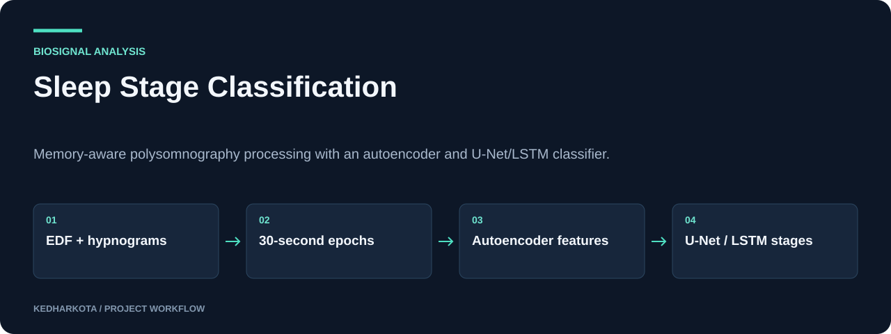

# Sleep Stage Classification

Memory-aware polysomnography processing with an autoencoder and U-Net/LSTM classifier.

**Python · PyTorch · MNE · NumPy · scikit-learn**

[](https://github.com/kedharkota/Sleep-Disorder-Analysis/actions/workflows/docs.yml)

[Overview](#overview) · [Getting started](#getting-started) · [Repository guide](#repository-guide) · [Reproducibility](docs/REPRODUCIBILITY.md)

<p align="center">
  
</p>

[Open full-size visual](docs/assets/overview.svg)

*Explanatory workflow diagram based on the committed project materials.*

## Project at a glance

| Detail | Project information |
| --- | --- |
| **Focus** | Five-class sleep-stage classification from biosignals |
| **Start here** | [main_memory_efficient.py](main_memory_efficient.py) |
| **Run mode** | Python training pipeline; external paired EDF and hypnogram data |
| **Explore** | Preprocessed epochs, learned features, checkpoints, and evaluation code |

## Overview

A Python research pipeline for five-class sleep-stage classification from polysomnography signals. The main entry point preprocesses EDF recordings into disk-backed arrays, learns a compact representation with a convolutional autoencoder, and trains a U-Net/LSTM classifier.

## What this project includes

- MNE-based EDF loading, annotation mapping, and 30-second epochs at 100 Hz.
- Disk-backed preprocessing and memory-mapped sample access.
- Convolutional autoencoder training and latent encoding.
- Class-weighted classification with accuracy, macro F1, and confusion-matrix reporting.

## Getting started

Create a Python environment and install the imported dependencies, selecting PyTorch for your CPU/CUDA platform:

```bash
python -m pip install numpy pandas mne torch scikit-learn scipy matplotlib tqdm
```

Arrange paired PSG/hypnogram EDF recordings under `dataset/` and, if used, a `dataset/RECORDS` file. Review the configuration inside `main()` for data limits, batch size, training epochs, and output paths.

```bash
python main_memory_efficient.py
```

No command-line argument parser is implemented; change configuration values in the script.

### Required inputs and current constraints

The recordings and trained weights are not committed. The memory-efficient loader handles Sleep-EDF-style `sleep-cassette` and `sleep-telemetry` naming and expects matching hypnograms. Check annotation/channel availability. Cached preprocessing goes under `preprocessed_data/`; checkpoints use `autoencoder.pt` and `classifier.pt`.

## Repository guide

| File | Purpose |
| --- | --- |
| [main_memory_efficient.py](main_memory_efficient.py) | Main preprocessing, training, and evaluation pipeline. |
| [data_processing.py](data_processing.py) | Alternative dataset/loading utilities. |
| [autoencoder.py](autoencoder.py) | Autoencoder, training helpers, and dataset encoding. |
| [cnn_lstm.py](cnn_lstm.py) | U-Net/LSTM classifier and training helpers. |

## Results and project status

The source computes metrics and writes a confusion matrix, but no completed evaluation results are committed. The implementation uses an epoch-level train/validation split; subject-independent generalization is not established. Cache memory savings apply mainly to the signal loader, while the later latent encodings are materialized in memory.

## Next steps

- Add a tested dependency environment and subject-level split definitions.
- Publish measured results, dataset provenance, and checkpoint configuration.

## Documentation maintenance

<details>
<summary>Run documentation checks and maintain visuals</summary>

Local documentation links and image headers are checked on pull requests and relevant pushes by the [documentation workflow](.github/workflows/docs.yml). Run the same check locally:

```bash
python tools/check_docs.py
```

See the [reproducibility guide](docs/REPRODUCIBILITY.md) for evidence, missing artifacts, and visual-source notes. The check validates documentation files; it does not train models or certify application behavior.

</details>

## Explore related projects

- [Cardiac Ultrasound Segmentation](https://github.com/kedharkota/-Heart-Murmur-)
- [Healthcare Recommendation Research Prototype](https://github.com/kedharkota/Healthcare-Recommendation-System)

---

[More projects by kedharkota](https://github.com/kedharkota?tab=repositories)
